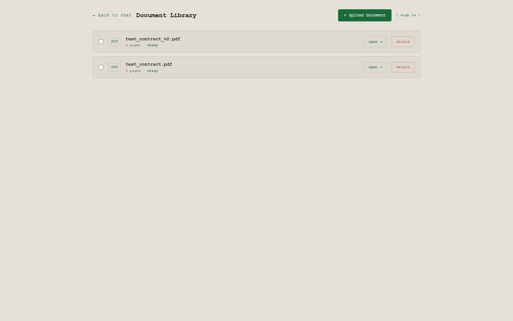
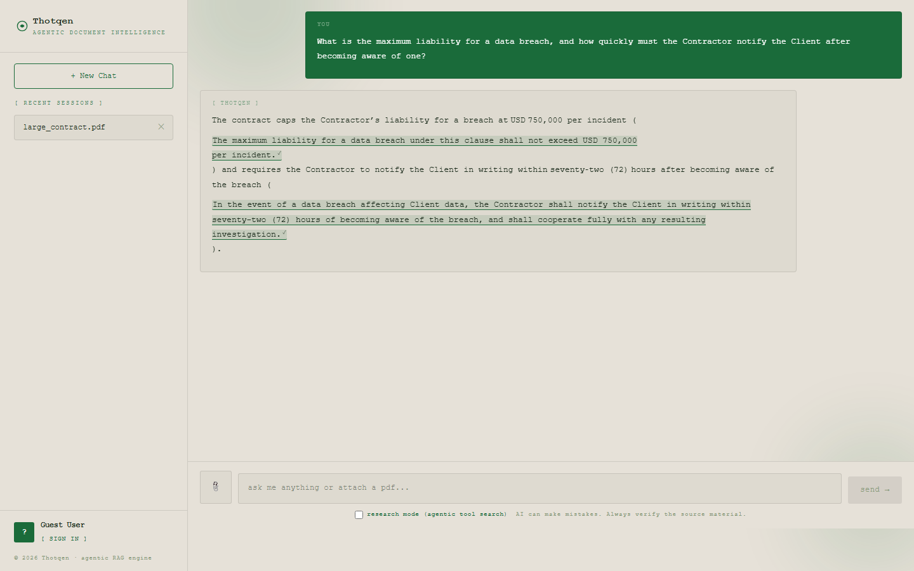
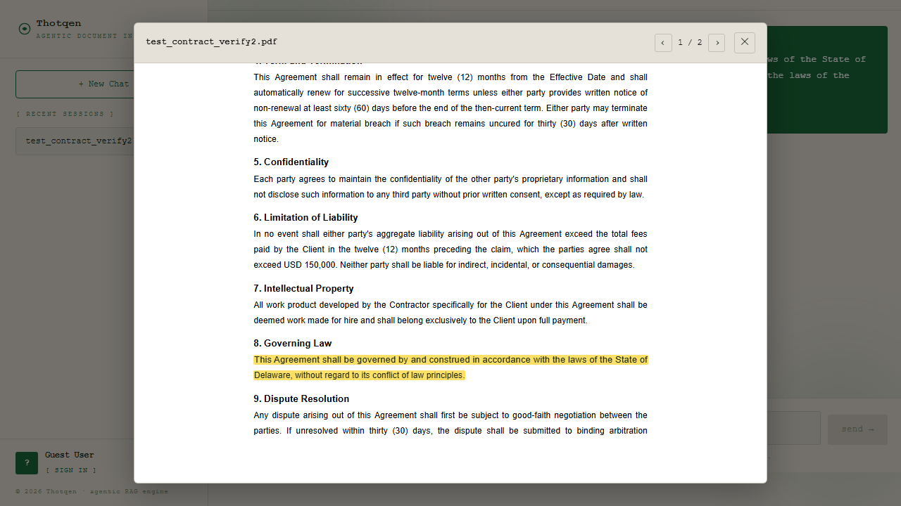

# Contract Copilot — Frontend

Next.js frontend for the legal-contract-analysis app. The backend (`../agentic-ai`) has the full project README — what the app does, how quote verification works, Part C details, and what's finished vs. not.

**Live app:** https://agentic-ai-application.ayushgurung.com/

## Screenshots

| Upload / library | Chat with verified quotes |
|---|---|
|  |  |

| Citation highlighting | Document comparison |
|---|---|
|  |  |

## Pages

- `/library` — document library: upload (PDF/DOCX), list, open, delete, select several documents to ask a cross-document question or compare two versions
- `/upload` — the chat interface (also reachable by opening a document from the library)
- `/compare?a=<id>&b=<id>` — paragraph-level comparison between two documents, filterable by how significant each change is

## Running locally

```bash
npm install
cp .env.example .env.local   # fill in NEXT_PUBLIC_API_URL + NEXT_PUBLIC_SUPABASE_*
npm run dev
```

Requires the backend (`../agentic-ai`) running and reachable at `NEXT_PUBLIC_API_URL`.

## Key pieces added for this assignment

- `components/DocumentViewer.tsx` — renders the original PDF (via `react-pdf`) or DOCX (via `mammoth`, client-side HTML conversion) and highlights a cited passage by searching the rendered text (whitespace-tolerant, matching the backend's verification rule), not by trusting any position the model reports.
- `lib/highlight.ts` — the shared find-and-highlight-in-the-DOM utility both viewers use.
- `lib/quotes.ts` — parses the backend's verified-quote wire protocol out of a streamed answer and attaches verified/unverified metadata to each quote span.
- `app/library/page.tsx`, `app/compare/page.tsx` — new pages for the document library and comparison view.
